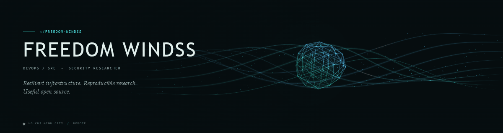

  

  <a href="https://1devops.io"><strong>Website</strong></a> ·
  <a href="https://www.linkedin.com/in/googlesky/">LinkedIn</a> ·
  <a href="mailto:hieulp@1devops.io">Email</a> ·
  <a href="https://1devops.io/#contact">Work with me</a>

## Hi, I'm Freedom Windss 👋

**Senior DevOps/SRE Engineer and Security Researcher** with **13+ years of experience** building resilient cloud infrastructure, automating delivery, and turning operational complexity into systems teams can confidently own.

I work across the full lifecycle — architecture, Kubernetes, Infrastructure as Code, CI/CD, observability, incident response, and security. I also publish open-source tools and reproducible vulnerability research with clear evidence, root-cause analysis, and mitigation guidance.

### What I focus on

- **Platform engineering:** production-grade Kubernetes, cloud architecture, GitOps, and automated delivery.
- **Reliability:** observability, performance, incident response, disaster recovery, and practical runbooks.
- **Security research:** hands-on analysis in isolated labs, validated against both vulnerable and patched versions.
- **Open source:** small, useful tools, community firmware, public datasets, and documentation that helps others reproduce the result.

> **Research approach:** reproduce → isolate root cause → validate vulnerable vs. fixed → document impact and mitigations.

## Explore my work

The lists below are generated from my public GitHub repositories — new projects appear automatically.

<!-- PROJECTS:START -->
### Latest security research

| Project | Description |
| --- | --- |
| [CVE-2026-129358](https://github.com/googlesky/CVE-2026-129358) | Magma NMS &lt;=1.9.0 stored XSS: org names stored unvalidated and rendered unescaped (!{configJson}, JSON.stringify leaves &lt;&gt; alone) — an org named xss-&lt;/script&gt;&lt;script&gt;… executes in every member's browser. Real NMS+Postgres; raw breakout vs… |
| [CVE-2026-129357](https://github.com/googlesky/CVE-2026-129357) | Magma NMS &lt;=1.9.0: /host subtree gates the tenant (Host header) but never the caller's role — a role-0 host-org user POSTs add_user with role:3 and manufactures SUPERUSER accounts. Real NMS server + Postgres + local auth; manufactured… |
| [CVE-2026-129360](https://github.com/googlesky/CVE-2026-129360) | Magma orc8r &lt;=1.9.0 obsidian REST: operator identity follows the spoofable X-Magma-Client-Cert-Serial header — knowing a registered serial is the whole auth, no certificate possession checked. Real middleware + real certifier client +… |
| [CVE-2026-129359](https://github.com/googlesky/CVE-2026-129359) | Magma orc8r &lt;=1.9.0: the public constant 7ZZXAF7CAETF241KL22B8YRR7B5UF401 in x-magma-client-cert-serial is accepted by the real identity interceptor with zero verification — internal-cloud trust for any caller. Real v1.9.0 component;… |
| [CVE-2026-129349](https://github.com/googlesky/CVE-2026-129349) | Apache Shiro &lt;=3.0.0 DefaultLdapRealm + authenticationCachingEnabled: one valid login, then ANY password (incl. empty) authenticates — cached auth skips the LDAP bind and AllowAllCredentialsMatcher accepts everything. Real realm + real in-… |
| [CVE-2026-129355](https://github.com/googlesky/CVE-2026-129355) | dufs &lt;=0.46.0 WebDAV COPY: overwrites existing destinations without the delete permission and ignores Overwrite: F (CWE-863). Both sides compiled from upstream (v0.46.0 vs fix commit fba13df): vuln 204+content replaced on every form; fixed… |

### Open source & community

| Project | Description |
| --- | --- |
| [vietlott-data](https://github.com/googlesky/vietlott-data) | Vietlott lottery data crawler - Auto-updated daily at midnight |
| [thue-2026](https://github.com/googlesky/thue-2026) | Công cụ tính thuế thu nhập cá nhân Việt Nam miễn phí. So sánh luật thuế cũ (7 bậc) và mới 2026 (5 bậc). Tính GROSS-NET, quyết toán thuế, thưởng Tết, ESOP, thuế chứng khoán, thuế cho thuê nhà, vay mua nhà. |
| [RG-MA2820-OpenWrt-Community](https://github.com/googlesky/RG-MA2820-OpenWrt-Community) | Community OpenWrt hybrid build system for Ruijie RG-MA2820(T), with per-device calibration, A/B rollback and wired roaming |
| [1sh.pw](https://github.com/googlesky/1sh.pw) | URL Shortener with Analytics on Cloudflare Workers |

Updated automatically from public repositories. Forks, archived projects, and repositories without descriptions are excluded.
<!-- PROJECTS:END -->

## Engineering toolbox

| Domain | Tools and practices |
| --- | --- |
| **Cloud & platforms** | AWS · Azure · GCP · Kubernetes · Docker |
| **IaC & delivery** | Terraform · Ansible · Helm · Argo CD · GitHub Actions · GitLab CI · Jenkins |
| **Observability** | Prometheus · Grafana · ELK · Datadog |
| **Security** | Vault · Falco · Trivy · DevSecOps · Vulnerability research |
| **Languages** | Go · Python · TypeScript · Shell · C |

### How I work

**Boring infrastructure where it matters, measurable reliability everywhere, and security claims backed by reproducible evidence.** I care about clean handover, useful documentation, and leaving teams stronger than I found them.

---

  Based in Ho Chi Minh City, Vietnam · Working remotely worldwide 
  <a href="https://1devops.io">1devops.io</a> · <a href="mailto:hieulp@1devops.io">hieulp@1devops.io</a>

