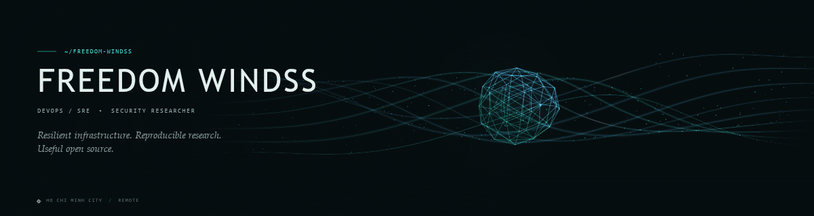

  

  <a href="https://1devops.io"><strong>Website</strong></a> ·
  <a href="https://www.linkedin.com/in/googlesky/">LinkedIn</a> ·
  <a href="mailto:hieulp@1devops.io">Email</a> ·
  <a href="https://1devops.io/#contact">Work with me</a>

## Hi, I'm Freedom Windss 👋

**Senior DevOps/SRE Engineer and Security Researcher** with **13+ years of experience** building resilient cloud infrastructure, automating delivery, and turning operational complexity into systems teams can confidently own.

I work across the full lifecycle — architecture, Kubernetes, Infrastructure as Code, CI/CD, observability, incident response, and security. I also publish open-source tools and reproducible vulnerability research with clear evidence, root-cause analysis, and mitigation guidance.

### What I focus on

- **Platform engineering:** production-grade Kubernetes, cloud architecture, GitOps, and automated delivery.
- **Reliability:** observability, performance, incident response, disaster recovery, and practical runbooks.
- **Security research:** hands-on analysis in isolated labs, validated against both vulnerable and patched versions.
- **Open source:** small, useful tools, community firmware, public datasets, and documentation that helps others reproduce the result.

> **Research approach:** reproduce → isolate root cause → validate vulnerable vs. fixed → document impact and mitigations.

## Explore my work

The lists below are generated from my public GitHub repositories — new projects appear automatically.

<!-- PROJECTS:START -->
### Latest security research

| Project | Description |
| --- | --- |
| [CVE-2026-100105](https://github.com/googlesky/CVE-2026-100105) | Grafana alerting contact point authorization bypass via schema downgrade (CVSS 7.7) — containerized lab, full PoC, plus 2 unreported findings reproducible on 13.2.5 |
| [CVE-2026-116244](https://github.com/googlesky/CVE-2026-116244) | pgAdmin 4 server mode: libpq answers GSSAPI with the service account's Kerberos credentials (CVE-2026-116244, fixed in v9.19) — containerized lab + PoC |
| [CVE-2026-116366](https://github.com/googlesky/CVE-2026-116366) | PoC for CVE-2026-116366 — ClickHouse Server unauthenticated RCE (brotli v1.2.0 decoder out-of-bounds write): differential detector, weaponized DoS, containerized vulnerable-vs-fixed lab, root-cause analysis |
| [CVE-2026-104623](https://github.com/googlesky/CVE-2026-104623) | PoC and Docker lab for CVE-2026-104623 — SUSE Rancher Manager local-cluster-shell authorization bypass: any authenticated user spawns a shell pod on the management cluster via alternate request forms that dodge the authorization gate.… |
| [CVE-2026-115560](https://github.com/googlesky/CVE-2026-115560) | PoC and Docker lab for CVE-2026-115560 — PHP session upload-progress serialize_handler mismatch to unauthenticated object injection / RCE. Validated end-to-end on php:8.4.27-apache with mitigation and no-switch controls. |
| [CVE-2026-111497](https://github.com/googlesky/CVE-2026-111497) | PoC, Docker lab, and technical report for CVE-2026-111497 (Node2Shell) — Node.js Brotli decoder invalid block-switch OOB write; validated errno differential and weaponized remote DoS, RCE analysis included. |

### Open source & community

| Project | Description |
| --- | --- |
| [vietlott-data](https://github.com/googlesky/vietlott-data) | Vietlott lottery data crawler - Auto-updated daily at midnight |
| [thue-2026](https://github.com/googlesky/thue-2026) | Công cụ tính thuế thu nhập cá nhân Việt Nam miễn phí. So sánh luật thuế cũ (7 bậc) và mới 2026 (5 bậc). Tính GROSS-NET, quyết toán thuế, thưởng Tết, ESOP, thuế chứng khoán, thuế cho thuê nhà, vay mua nhà. |
| [RG-MA2820-OpenWrt-Community](https://github.com/googlesky/RG-MA2820-OpenWrt-Community) | Community OpenWrt hybrid build system for Ruijie RG-MA2820(T), with per-device calibration, A/B rollback and wired roaming |
| [1sh.pw](https://github.com/googlesky/1sh.pw) | URL Shortener with Analytics on Cloudflare Workers |

Updated automatically from public repositories. Forks, archived projects, and repositories without descriptions are excluded.
<!-- PROJECTS:END -->

## Engineering toolbox

| Domain | Tools and practices |
| --- | --- |
| **Cloud & platforms** | AWS · Azure · GCP · Kubernetes · Docker |
| **IaC & delivery** | Terraform · Ansible · Helm · Argo CD · GitHub Actions · GitLab CI · Jenkins |
| **Observability** | Prometheus · Grafana · ELK · Datadog |
| **Security** | Vault · Falco · Trivy · DevSecOps · Vulnerability research |
| **Languages** | Go · Python · TypeScript · Shell · C |

### How I work

**Boring infrastructure where it matters, measurable reliability everywhere, and security claims backed by reproducible evidence.** I care about clean handover, useful documentation, and leaving teams stronger than I found them.

---

  Based in Ho Chi Minh City, Vietnam · Working remotely worldwide 
  <a href="https://1devops.io">1devops.io</a> · <a href="mailto:hieulp@1devops.io">hieulp@1devops.io</a>

